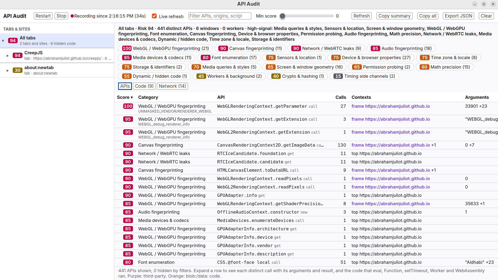
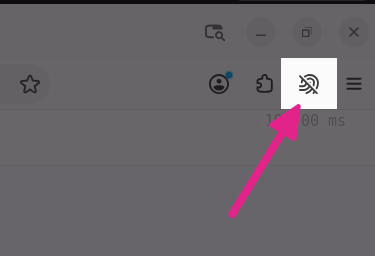

# InstruFox

InstruFox is a web browser for research. It shows you everything a website
does inside the browser: every Web API it calls and what came back, the code
it runs (including code generated at runtime or hidden in short-lived
workers), the CSS conditions it probes, and every network request and cookie
it produces. Results are grouped by tab, frame and worker, ranked by privacy
risk, and can be exported as JSON or Markdown.

InstruFox is built on the Firefox source code and is updated with the latest
Firefox changes every week, so it keeps up with new web platform features,
bug fixes and security fixes. It is an independent project, not affiliated
with or endorsed by Mozilla.



*The API Audit window after loading the
[CreepJS](https://abrahamjuliot.github.io/creepjs/) fingerprinting test
page: 441 distinct APIs, ranked by risk and grouped by category.*

## Who it's for

Anyone who needs to see what a page actually does, not what it claims to do:

- **Fingerprinting researchers**: see which canvas, WebGL, audio, font,
  locale, math, screen, sensor and hardware APIs a script reads, with the
  exact arguments it passed and the values it got back.
- **Tracker and ad-tech analysts**: connect API reads to the network requests
  and cookies that follow, along with how tracking protection classified each
  request.
- **Anti-bot and anti-fraud analysts**: capture the code these scripts build
  at runtime with `eval`, `Function`, string timers and WebAssembly, including
  code that only runs inside workers that exit right away.
- **Security researchers studying malicious or obfuscated JavaScript**: get
  the deobfuscated code as the browser compiles it, spot anti-debugging
  tricks, and keep DevTools hidden from pages that look for it.
- **Web measurement studies**: export a complete, structured report per page
  to compare sites, browsers or versions of a page.

> **Your data stays on your computer.** InstruFox doesn't send what it
> records anywhere. Recordings are kept in memory and are gone when you
> click **Clear** or close the browser; they are only saved to a file when
> you export them. Keep in mind that a report can include cookies, request
> headers and form data from the pages you visited, so check it before you
> share it.

## What it records

| Area | What is captured |
| --- | --- |
| Web APIs | Every method, getter, setter and constructor that a page calls, in the page itself and in dedicated, shared and service workers: how often, with which arguments, what it returned (including what promises resolve or reject with), any exception, and the calling script as `url:line:col`. |
| JavaScript builtins | The builtins that reveal time zone, locale and floating-point behavior: the `Date` time zone methods, every `Intl.*.resolvedOptions()`, `Intl.supportedValuesOf()`, `Temporal.Now.timeZoneId()` and the transcendental `Math` functions. |
| Code | Inline and external `<script>`, module scripts, worker and `importScripts()` sources (including blob: and data: URLs), `eval()` and `Function()` strings, string `setTimeout()` and `setInterval()`, inline event handlers, `javascript:` URLs, and WebAssembly modules, which you can save as `.wasm` files. |
| CSS | `@media`, `@supports` and `@import` conditions in page stylesheets and whether they matched, and `src: local()` font lookups and whether the font was found. |
| Network | Every request a page makes: URL, method, type, status, request and response headers, request body, remote address and tracking protection classification. Also every cookie change and each tab's content blocking log. |
| Anti-debugging | Code that contains `debugger` statements is flagged, and each time such code is compiled it is recorded. |

Every API gets a risk score from 0 (harmless) to 100 and a category: canvas,
WebGL / WebGPU, audio, fonts, device and browser properties, time zone and
locale, math precision, screen geometry, media devices, sensors, network /
WebRTC leaks, storage and identifiers, permission probing, crypto, timing side
channels, CSS media queries, clipboard, navigation, workers, dynamic code and
anti-debugging. Some scores depend on the arguments: for example,
`getParameter(37446)` asks for the real graphics card name
(`UNMASKED_RENDERER_WEBGL`) and ranks high.

### Hiding DevTools from pages

Many scripts behave differently, or stop working, when they notice DevTools
is open. InstruFox counters the common tricks:

- Pausing on `debugger;` statements is off, and DevTools opens in its own
  window, so pages can't detect it by timing `debugger` or by watching the
  window shrink.
- Console calls take the same time whether or not DevTools is open, so
  timing `console.log` or `console.table` gives nothing away.
- Workers loaded from blob: and data: URLs stay listed in DevTools after they
  exit, so a page can't hide code in a worker that closes itself immediately.

You can turn all of this off with the `privacy.apiaudit.hideDevTools`
preference.

## Install

On Linux x86_64, download `InstruFox-<version>-linux-x86_64.tar.xz` from the
[Releases](https://github.com/SrikanthKumarC/InstruFox/releases) page, then
run:

```sh
tar -xJf InstruFox-*-linux-x86_64.tar.xz
./instrufox/instrufox
```

InstruFox keeps its own profile in `~/.config/mozilla/instrufox` and never
touches your Firefox profile. To start every session from a clean slate, use
a throwaway profile instead:

```sh
./instrufox/instrufox --profile "$(mktemp -d)"
```

It needs the same system libraries as Firefox, such as GTK 3. InstruFox
doesn't update itself; check the Releases page for new versions.

### Supported platforms

| Platform | Status |
| --- | --- |
| Linux x86_64 | Available |
| Linux ARM64 | Coming soon |
| Windows x86_64 | Coming soon |
| Windows ARM64 | Coming soon |

To hear when a new platform is available, watch this repository and choose
*Custom > Releases*.

## Getting started

1. Click the **API Audit** button in the toolbar, next to the extensions
   button. If you don't see it, add it from *Customize Toolbar*.

   

2. Click **Start**, then load the page you want to study. While recording,
   **Restart** clears what was recorded and starts over, **Stop** pauses and
   keeps the data, **Resume** continues, and **Clear** deletes everything.
3. In the sidebar, pick a tab, page load, frame or worker to see what it and
   everything inside it did:
   - **APIs** lists every API used, highest risk first. Expand a row to see
     each distinct call with its arguments, result and calling script.
   - **Code** lists the code that was captured, with code from blob: and
     data: workers, runtime-generated code and anti-debugging code flagged.
   - **Network** lists requests, cookie changes and the content blocking log.
     Click a request to see its headers, body and classification.

   Use the filter box to search APIs, origins and scripts, and the **Min
   score** slider to hide low-risk APIs (below 30 by default).
4. To export, use **Export JSON** to save the full report of the selected
   page to your Downloads folder, **Copy all** to copy the same report to the clipboard, or
   **Copy summary** for a Markdown overview grouped by category, with the
   captured code and the hosts the page contacted.

### Preferences

You can change these in `about:config`:

| Preference | Default | What it does |
| --- | --- | --- |
| `privacy.apiaudit.enabled` | `true` | Turns recording on or off. |
| `privacy.apiaudit.hideDevTools` | `true` | Hides DevTools from pages, as described above. |
| `privacy.apiaudit.maxCodeLength` | `524288` | Maximum number of characters kept for each piece of captured code. |
| `privacy.apiaudit.retainSeconds` | `600` | How long, in seconds, data from closed tabs is kept. |

To also get a plain-text log in the terminal, start InstruFox with
`MOZ_LOG=ApiAudit:3` (first use of each API per page) or `MOZ_LOG=ApiAudit:5`
(every recorded call).

## Limitations

- For heavily optimized code, call counts of some builtins and getters are
  lower than the real number, because the JavaScript engine can skip them
  after the first calls. Every script that calls them is still listed.
- JavaScript builtins other than the ones listed above, such as
  `Function.prototype.toString` or `Error.prototype.stack`, are not recorded.
- Page objects passed as arguments are shown only by their type (for example
  `HTMLCanvasElement`), because describing them in more detail would mean
  running page code.
- Container queries and other conditions checked while matching CSS
  selectors are not recorded.
- A page can still detect DevTools by measuring how much it slows down
  overall while the debugger is attached, or by flooding the console and
  measuring event loop delays.

## Building from source

InstruFox is a fork of
[mozilla-firefox/firefox](https://github.com/mozilla-firefox/firefox). Every
week, the InstruFox changes are rebased onto the latest Firefox `main`
branch, so the history of `main` here is rewritten when that happens. If you
work from a clone, update it with `git pull --rebase`, and base pull requests
on the current `main`.

InstruFox builds the same way as Firefox. See the
[Firefox build documentation](https://firefox-source-docs.mozilla.org/setup/index.html)
for system requirements. In a clone of this repository:

```sh
echo '. "$topsrcdir/browser/branding/instrufox/mozconfig"' >> mozconfig
./mach bootstrap   # first time only; choose "Firefox for Desktop"
./mach build
./mach run
```

The first line applies the InstruFox name and branding. Without it you get
an unbranded build named Nightly. `./mach package` creates a tarball like
the released one in `obj-*/dist/`.

To run the tests:

```sh
./mach test toolkit/components/apiaudit/tests/browser/ --headless
```

[toolkit/components/apiaudit/README.md](toolkit/components/apiaudit/README.md)
explains how the recording works and lists every change InstruFox makes to
the Firefox source.

## Contributing

Issues and pull requests are welcome. For example: things InstruFox records
incorrectly or misses, risk scores and categories, DevTools detection tricks
it doesn't handle yet, export formats, documentation and packaging.

- **Issues:** use the
  [issue tracker](https://github.com/SrikanthKumarC/InstruFox/issues).
  Include your InstruFox version, the page or a small test case, and what was
  recorded compared to what you expected.
- **Pull requests:** most of the code is in `toolkit/components/apiaudit/`.
  Keep changes elsewhere in the Firefox source as small as you can, so
  InstruFox stays easy to update to newer Firefox versions, and add or update
  a test in `toolkit/components/apiaudit/tests/browser/`.

**Firefox bugs belong with Mozilla, not here.** If a problem also happens in
regular Firefox, report it on [Bugzilla](https://bugzilla.mozilla.org/). If
you aren't sure, try to reproduce it in
[Firefox Nightly](https://www.mozilla.org/firefox/channel/desktop/#nightly)
first. Likewise, please don't report InstruFox problems to Mozilla.

## License

InstruFox is licensed under the
[Mozilla Public License 2.0](https://www.mozilla.org/MPL/2.0/), like Firefox.
Firefox and the Firefox logos are trademarks of the Mozilla Foundation and are
not used by this project.
